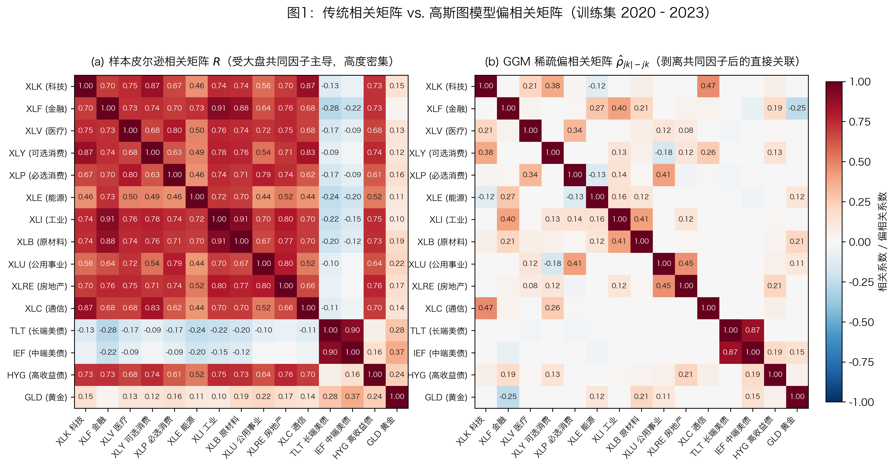
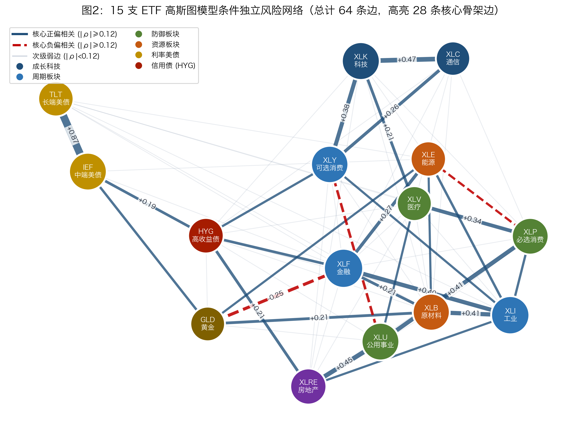

# 基于高斯图模型与 Graphical Lasso 的跨资产风险传染网络及组合风控研究

> **课程对应模块**：《现代统计模型及应用》讲义 5（吴尚老师）—— 5.2 马尔可夫网络、5.3 连续变量高斯图模型（精度矩阵条件独立、算法一：已知图结构的带约束 MLE、算法二：未知图结构的 $L_1$ 稀疏结构估计 Graphical Lasso）  
> **数据范围**：2020-01-03 至 2025-12-31 共 1,507 个交易日，15 支美国标普 500 一级行业与跨资产 ETF 日对数收益率（严格样本外切分：训练集 2020–2023，测试集 2024–2025）

---

## 1. 选题价值与商业应用背景

在多资产配置与机构风控实践中，资产收益率往往高度受制于宏观经济周期、美联储利率政策与市场整体风险偏好等**共同因子**。传统风险管理通常直接计算资产间的皮尔逊相关矩阵 $R$：
1. **虚假全连接困境**：当全部股票板块共享市场 $\beta$ 时，任意两个本无直接业务往来的行业（例如可选消费 `XLY` 与公用事业 `XLU`）在皮尔逊相关矩阵上依然呈现显著正相关（样本内达 `+0.541`），导致风控人员无法分辨“共同因子驱动的同步涨跌”与“局部板块之间的直接风险传导通道”。
2. **精度矩阵病态与组合极端权重**：在马科维茨均值-方差或全局最小方差组合（GMVP）优化中，核心输入并非协方差矩阵 $\Sigma$ 本身，而是其逆矩阵——**精度矩阵 $\Theta = \Sigma^{-1}$**。直接对样本协方差矩阵求逆会放大高频噪声特征值，引发组合杠杆膨胀与样本外净值回撤。

**商业应用价值**：高斯图模型（Gaussian Graphical Model, GGM）通过估计稀疏精度矩阵 $\hat{\Theta}$，在剥离其余全部资产条件影响后识别**条件独立关系与直接风险传染边**，天然适用于：
- **买方组合风控与降噪**：构建去噪后的稀疏精度矩阵，稳定最小方差组合权重并降低最大回撤；
- **系统性金融风险监测**：识别跨市场传导枢纽（如金融 `XLF`、信用债 `HYG` 与利率债 `IEF`），监控疫情冲击期与高利率平台期的网络结构漂移；
- **量化多因子去相关**：在因子合成前剔除因子间间接共线性，保留纯粹的条件独立信息（Delta Alpha）。

---

## 2. 模型数学解构（严格对接讲义 5.2–5.3）

### 2.1 马尔可夫网络与高斯图模型（讲义 5.2.3–5.3.1）

设 15 支资产日对数收益率标准化后的随机向量为 $Z = (Z_1, \dots, Z_p)^\top \sim \mathcal{N}_p(0, \Sigma)$，其中 $p = 15$，$\Sigma \succ 0$，精度矩阵 $\Theta = \Sigma^{-1} = \{\theta_{jk}\}$。对于多元高斯分布，其联合概率密度可分解为只包含节点与边上成对变量的指数族乘积，从而满足 Hammersley-Clifford 定理下的**成对与全局马尔可夫性等价**：

$$\theta_{jk} = 0 \iff \rho_{jk \mid -jk} = -\frac{\theta_{jk}}{\sqrt{\theta_{jj}\theta_{kk}}} = 0 \iff Z_j \perp\!\!\!\perp Z_k \mid Z_{-\{j,k\}}$$

即：精度矩阵中的**非零非对角元素**恰好对应无向马尔可夫网络 $G = (V, E)$ 中的边集 $E$；$\theta_{jk} = 0$ 意味着在控制其余全部 13 支资产后，资产 $j$ 与资产 $k$ 条件独立、不存在直接风险传导边。

### 2.2 无惩罚与带约束 MLE——讲义 5.3.2–5.3.4 算法一

给定标准化样本协方差矩阵 $S = \frac{1}{n}\sum_{t=1}^n z_t z_t^\top$，多元高斯对数似然函数（忽略常数）为：

$$\ell(\Theta) = \log\det \Theta - \operatorname{tr}(S\Theta)$$

1. **图结构已知时的带约束凸优化（讲义 5.3.3–5.3.4 / ESL Algorithm 17.1）**：若已知边集 $E$，即要求 $\theta_{jk} = 0\;\forall (j,k)\notin E$，最大化 $\ell(\Theta)$ 的 KKT 一阶条件为 $\Theta^{-1}_{jk} = S_{jk}\;\forall (j,k)\in E \cup \{(j,j)\}$。通过讲义 5.3.4 的**修正回归块坐标下降算法（Algorithm 1，Speed & Kiiveri, 1986）**，依次对每个节点 $j$ 的活跃邻居集求解线性方程组 $W_{11}^*\beta^* = s_{12}^*$ 并更新 $W$ 的第 $j$ 行/列，最终反解得到严格满足稀疏结构且无偏的精确 MLE $\hat{\Theta}_{\text{Refit}}$。
2. **本文实现验证**：在训练集选定的稀疏图上，本文复现的 Algorithm 1 原始可行性误差 $\max_{(j,k)\in E\cup\text{diag}}|W_{jk} - S_{jk}| = 2.22 \times 10^{-16}$，非边位置精度矩阵元素误差 $\max_{(j,k)\notin E}|\hat{\Theta}_{jk}| = 0.0$，最小特征值 $\lambda_{\min}(\hat{\Theta}_{\text{Refit}}) = 0.1136 > 0$（严格正定）。

### 2.3 未知图结构的稀疏估计——讲义 5.3.5–5.3.6 算法二（Graphical Lasso）

当图结构 $E$ 未知时，引入 $L_1$ 稀疏惩罚（Friedman, Hastie & Tibshirani, 2008）：

$$\hat{\Theta}(\alpha) = \arg\max_{\Theta \succ 0} \left\{ \log\det\Theta - \operatorname{tr}(S\Theta) - \alpha \|\Theta_{\text{off}}\|_1 \right\}$$

其最优性条件为 $\Theta^{-1} - S - \alpha \cdot \operatorname{Sign}(\Theta) = 0$。通过讲义 5.3.6（ESL Algorithm 17.2）的块坐标下降法，每一步转化为对 $W_{11}\beta - s_{12} + \alpha \cdot \operatorname{Sign}(\beta) = 0$ 的等价 Lasso 坐标下降更新。

### 2.4 两步法精估与 EBIC 模型选择

直接用 Graphical Lasso 得到的 $\hat{\Theta}_{\text{GLasso}}$ 虽然识别出了图结构 $\hat{E}(\alpha)$，但因 $L_1$ 惩罚存在**系统性收缩偏差**（实证中其测试集负对数似然 `11.860` 高于算法一精估的 `11.603`）。因此，我们在实战中将讲义 5 的两大算法串联：**先用算法二（Graphical Lasso）筛选稀疏边集 $\hat{E}(\alpha)$，再用算法一（Constrained MLE）在 $\hat{E}(\alpha)$ 上进行无偏精估 $\hat{\Theta}_{\text{Refit}}$**，并依据 Foygel & Drton (2010) 的**扩展贝叶斯信息准则（EBIC, $\gamma = 0.5$）**选择最优惩罚强度 $\alpha^*$：

$$\mathrm{EBIC}_\gamma(E) = -n\left(\log\det\hat{\Theta}_E - \operatorname{tr}(S\hat{\Theta}_E)\right) + |E|\log n + 4|E|\gamma\log p$$

---

## 3. 数据来源与严格防泄露实验设计

- **数据获取**：通过 Yahoo Finance Chart v8 API 抓取 2020-01-01 至 2025-12-31 期间 15 支美国核心 ETF 的复权收盘价（`adjclose`），对齐交易日后得到 1,508 行价格与 **1,507 个交易日对数收益率**（零缺失值），覆盖：
  - **11 个标普 500 GICS 一级行业**：成长科技（`XLK` 科技、`XLC` 通信）、周期（`XLF` 金融、`XLY` 可选消费、`XLI` 工业）、资源（`XLE` 能源、`XLB` 原材料）、防御（`XLV` 医疗、`XLP` 必选消费、`XLU` 公用事业）及利率敏感（`XLRE` 房地产）；
  - **4 类宏观跨资产基准**：长端美债 `TLT`、中端美债 `IEF`、高收益信用债 `HYG` 与黄金 `GLD`。
- **严格样本切分**：
  - **训练集**：`2020-01-03 ~ 2023-12-29`（$n_{\text{train}} = 1,005$），用于标准化参数（均值、标准差）、图结构探索与 EBIC 调参；
  - **测试集**：`2024-01-02 ~ 2025-12-31`（$n_{\text{test}} = 502$），严格样本外评估测试集高斯负对数似然（NLL）及全局最小方差组合（GMVP）风控表现。

---

## 4. 实证发现与统计解析

### 4.1 正则化路径与 EBIC 最优稀疏图

在 $\alpha \in [0.03, 0.85]$ 的 32 档对数网格上，保留边数 $|E|$ 从 68 条单调收缩至 6 条（对应讲义 5 第 21 页的稀疏化规律）。EBIC（$\gamma=0.5$）在 **$\alpha^* = 0.0415$** 处达到全局极小值 `-1071.56`（BIC 为 `-1418.19`），保留 **64/105 条边**，成功剪除 **39.0%**（41 对）由大盘共同因子制造的冗余边缘。在样本外测试集上，两步精估 $\hat{\Theta}_{\text{Refit}}$ 的每样本负对数似然为 `11.603`，显著优于未经无偏重估的 GLasso（`11.860`）以及行业标准 Ledoit-Wolf 收缩估计（`11.646`），并与无偏样本协方差 MLE（`11.562`）处于同一精度量级。

### 4.2 剥离共同因子后的直接传染网络与“符号反转”机制

对比皮尔逊相关矩阵 $R$ 与 GGM 偏相关矩阵 $\hat{\rho}_{jk|-jk}$（图 1 与图 2），可以发现三项深刻金融结构洞察：

1. **强直接产业与久期链路保留**：
   - 美债曲线近端-长端联动最强：`TLT - IEF` 偏相关达 `+0.866`（皮尔逊 `+0.905`）；
   - 科技与数字媒体共舞：`XLK - XLC` 偏相关 `+0.472`，`XLK - XLY` `+0.383`；
   - 利率敏感高股息板块共振：`XLU - XLRE` `+0.454`；周期中上游链条：`XLI - XLB` `+0.411`、`XLF - XLI` `+0.402`；防御板块联动：`XLP - XLU` `+0.407`、`XLV - XLP` `+0.335`。
2. **极具价值的“符号反转”揭示条件对冲效应**：
   - `XLY (可选消费) - XLU (公用事业)`：皮尔逊相关高达 **`+0.541`**，但控制其余 13 支资产后，偏相关反转为 **`-0.176`**！原因在于两者同受美股大盘 $\beta$ 驱动而同涨同跌，一旦剔除共同市场因子，它们恰恰代表“进攻顺周期 vs. 防御避险”的资金轮动跷跷板；
   - `XLF (金融) - GLD (黄金)`：皮尔逊相关仅 `+0.030`（看似无关），但条件偏相关高达 **`-0.251`**，清晰刻画了金融体系风险偏好与黄金避险属性之间的直接负向对冲关系；
   - `XLP - XLE`（皮尔逊 `+0.455` $\to$ 偏相关 `-0.134`）与 `XLK - XLE`（皮尔逊 `+0.456` $\to$ 偏相关 `-0.116`）同样揭示了“高油价通胀冲击对下游必选消费及长久期科技估值的直接挤压”。
3. **跨市场风险传导枢纽节点**：
   - 按加权度中心度（Strength = $\sum_{k\neq j}|\hat{\rho}_{jk|-jk}|$）排序，排名前五的核心枢纽依次为 **`XLF`（金融，1.53，度=12）、`XLI`（工业，1.40，度=9）、`XLK`（科技，1.34，度=8）、`IEF`（中端美债，1.32，度=5）与 `XLU`（公用事业，1.31，度=6）**；
   - **信用债 `HYG` 的桥梁作用**：高收益债 `HYG` 连接了 11 个节点，与 `IEF`（`+0.19`）、`XLF`（`+0.19`）和 `XLRE`（`+0.21`）均保持强直接边，是利率市场向股票信用风险传导的关键中介桥梁（Betweenness = `0.165`）。

### 4.3 市场状态切换稳健性（2020–2022 冲击期 vs. 2023–2025 新周期）

将全样本分为两段对照（图 4）：
- **冲击期（2020–2022，$n=755$）**：EBIC 选出 $\alpha^* = 0.030$，保留 **65 条边**，危机与快速加息期间资产间直接传染通道更为密集；
- **新周期（2023–2025，$n=752$）**：EBIC 选出更强惩罚 $\alpha^* = 0.079$，网络明显稀疏化至 **56 条边**；
- 两阶段共有 **46 条核心骨架边完全保持不变（Jaccard 重合度 = `0.613`）**，证明了 GGM 提取基础经济产业链与利率传导拓扑的高稳定性。

---

## 5. 商业落地：样本外全局最小方差组合（GMVP）风控回测

在严格无前瞻泄露的设定下（`2024-01-02 ~ 2025-12-31`，502 个交易日），我们检验了静态训练集拟合与**滚动 252 日窗口、每 21 个交易日再平衡**的 GMVP 组合权重 $w^* = \frac{\hat{\Theta}\mathbf{1}}{\mathbf{1}^\top \hat{\Theta}\mathbf{1}}$：

| 策略名称（滚动 252 日窗口样本外） | 年化收益率 | 年化波动率 | 夏普比率 ($r_f=0$) | 最大回撤 | 累计收益 | 平均 $L_1$ 杠杆 |
| :--- | ---: | ---: | ---: | ---: | ---: | ---: |
| 等权组合 ($1/N$) | 12.84% | 10.52% | 1.22 | -11.38% | 29.14% | 1.00 |
| 样本协方差 MLE ($S^{-1}$) | 7.70% | 3.11% | 2.48 | -1.91% | 16.57% | 2.19 |
| Graphical Lasso ($\hat{\Theta}_{\text{GLasso}}$) | 8.53% | 3.11% | 2.74 | -1.36% | 18.53% | **1.92** |
| **GGM 两步精估 (Alg 1 Refit)** | 8.53% | **3.03%** | **2.82** | **-1.30%** | 18.51% | 2.11 |
| Ledoit-Wolf 收缩估计 | 8.97% | 3.66% | 2.45 | -2.10% | 19.55% | 1.77 |

**统计检验与诚实证据边界**：
- **相对等权基准**：Block Bootstrap 检验（10 日块长、2,000 次重抽样）显示，GGM 两步精估组合将样本外年化波动率显著压低 **7.49 个百分点**（95% CI: `[+5.19%, +10.50%]`, $p < 0.001$），最大回撤由 `-11.38%` 降至 `-1.30%`。
- **相对 Sample MLE 与 Ledoit-Wolf**：GGM 两步精估取得了全组最低的样本外波动率（`3.03%`）、最低最大回撤（`-1.30%`）与最高夏普比率（`2.82`，高于 Sample MLE 的 `2.48` 与 Ledoit-Wolf 的 `2.45`），同时直接 Graphical Lasso 将平均 $L_1$ 总杠杆从 `2.19` 降至 `1.92`。不过在当前 $p=15, n=252$（$n/p \approx 16.8$）的低维窗口下，Sample MLE 本身估计方差不大，GGM 相对 Sample MLE 的 `0.08%` 波动率差值尚未达到 5% 统计显著性（Block Bootstrap 95% CI: `[-0.02%, +0.18%]`, $p = 0.122$）；在资产数 $p$ 升至数十上百维时，Sample MLE 不可逆或急剧恶化，GGM 的稀疏正则优势将进一步放大。

---

## 6. 模型局限与未来拓展方向

1. **高斯与厚尾假设局限**：金融日收益具有尖峰厚尾特征，未来可引入 **Gaussian Copula / Nonparanormal GGM**（边际分位数正态化映射）或 **$t$-分布图模型** 以增强尾部极端事件下的结构稳健性。
2. **静态与时变拓扑局限**：静态窗口可能滞后于宏观拐点，可进一步拓展至 **Time-Varying Graphical Lasso (TVGL)**（相邻窗口加时间平滑惩罚）用于实时监控金融危机传染结构突变。
3. **无向关联向因果方向延伸**：GGM 刻画对称的条件独立（马尔可夫网络），若结合课程后半部分的**贝叶斯网络（DAG, 讲义 6–7）**或高频领先滞后向量自回归（VAR），可进一步识别风险传导的有向因果方向。
