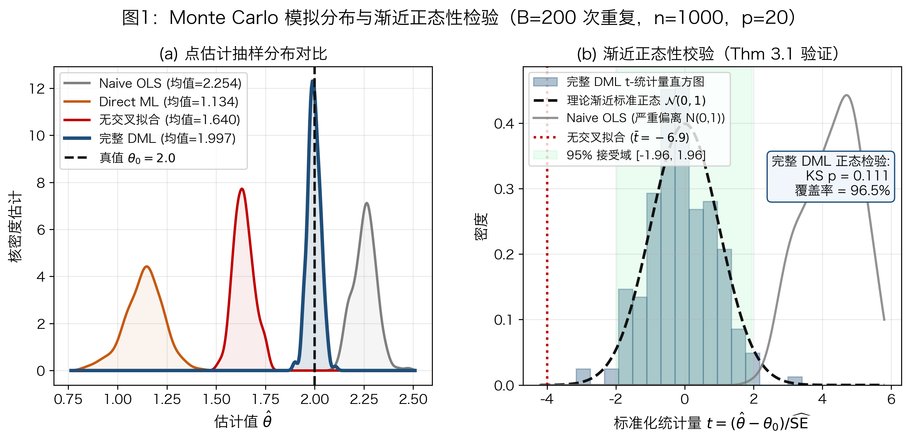
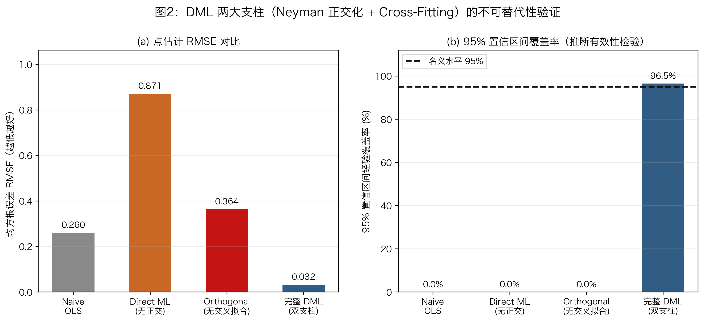
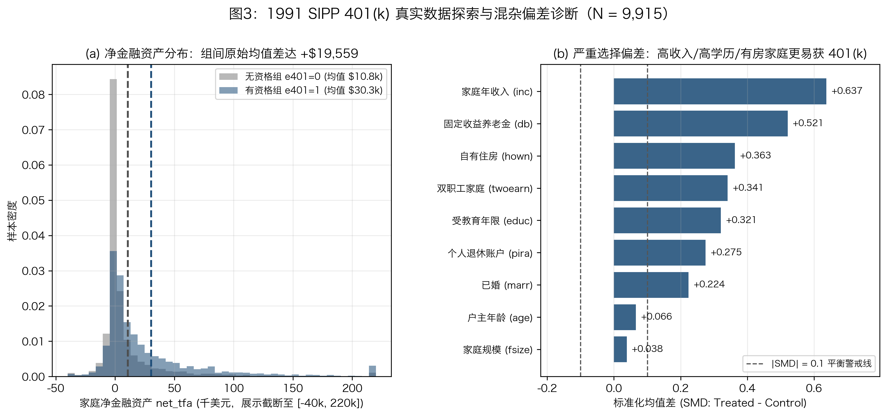
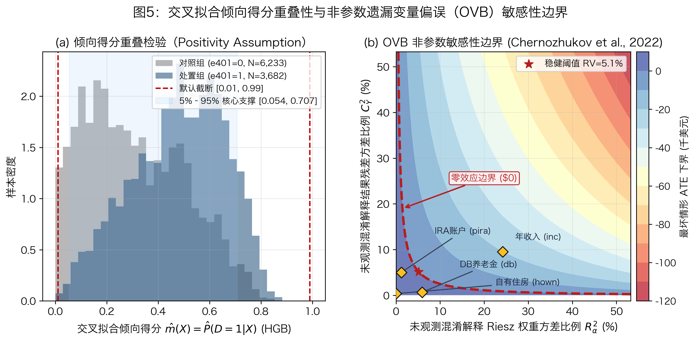
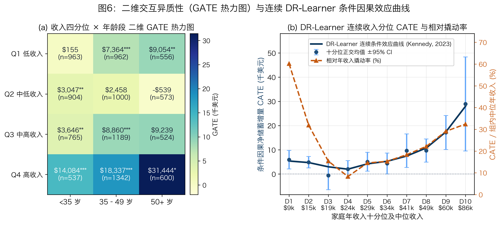

# 基于双重机器学习（DML）的 401(k) 养老金净储蓄因果效应与异质性研究

> **研究摘要**：针对高维非线性混杂条件下传统参数回归易受函数形式误设影响、而直接引入机器学习预测模型又会导致正则化偏误与过拟合偏误的难题，本研究系统分析并实现了 Chernozhukov 等（2018）提出的**双重机器学习（Double / Debiased Machine Learning, DML）**框架。通过 **200 次 Monte Carlo 模拟实验**与 **1991 年美国 SIPP 401(k) 家庭金融调查数据（$N = 9,915$）** 的综合检验，本文系统评估了 DML 的有限样本统计推断性能、跨学习器稳健性及收入异质性经济含义。

---

## 1. 模型提出背景与文献综述

在现代经济学、金融学与商业因果决策实践中，研究者往往需要在包含大量协变量 $X$ 与复杂非线性、高阶交互关系的观测数据中，识别某一核心处置变量 $D$ 对结果变量 $Y$ 的结构性因果效应 $\theta_0$。围绕该目标，计量经济学与统计学因果推断方法经历了四个关键演进阶段：

1. **潜在结果框架与倾向得分匹配（Neyman, 1923; Rubin, 1974; Rosenbaum & Rubin, 1983）**：形式化界定了反事实因果效应及条件可忽略性（Unconfoundedness）假设，并通过倾向得分将高维协变量平衡降维至一维条件概率。然而传统倾向得分匹配（PSM）通常依赖参数化 Logit 设定，且一对一匹配过程容易舍弃部分对照样本，导致估计方差偏大。
2. **部分线性半参数回归（Robinson, 1988）**：提出通过分别拟合条件期望 $\mathbb{E}[Y \mid X]$ 与 $\mathbb{E}[D \mid X]$ 并对残差进行回归，从而在低维非参数场景中获得主参数的 $\sqrt{n}$-一致性。
3. **双稳健增广逆概率加权（Robins, Rotnitzky & Zhao, 1994）**：构建了联合结果条件均值模型与倾向得分加权的双稳健（Doubly Robust / AIPW）矩方程，当两者之一设定正确时即保证一致估计，降低了单一模型误设风险。
4. **高维正则化去偏与双重机器学习（Belloni, Chernozhukov & Hansen, 2014; Chernozhukov et al., 2018）**：在高维数据环境下引入稀疏回归、随机森林、梯度提升树等现代机器学习算法拟合高维扰动函数（Nuisance Functions），并通过 **Neyman 正交化** 与 **$K$-折交叉拟合** 消除了机器学习带来的高阶偏误与过拟合相关性，使主参数在任意机器学习器达到 $o(n^{-1/4})$ 收敛速率时即可恢复 $\sqrt{n}$-渐近正态性。

---

## 2. 双重机器学习（DML）数学原理与统一估计框架

### 2.1 部分线性框架与机器学习的两类致命偏误

考虑 Robinson (1988) 部分线性回归模型（Partially Linear Regression, PLR）：

$$Y = \theta_0 D + g_0(X) + \zeta, \quad \mathbb{E}[\zeta \mid X, D] = 0$$
$$D = m_0(X) + V, \quad \mathbb{E}[V \mid X] = 0$$

其中 $\theta_0$ 为目标因果效应参数，$g_0(X)$ 与 $m_0(X)$ 均为高维未知非线性函数。若将机器学习算法直接代入上述结构方程，估计量会遭遇两类系统性偏误：

1. **正则化偏误（Regularization Bias）**：若仅利用机器学习拟合 $\hat{g}(X)$ 后，直接将 $Y - \hat{g}(X)$ 对 $D$ 做简单回归（Direct ML Plug-in），为抑制高维过拟合而施加的正则化惩罚会使 $\hat{g} - g_0$ 的收敛速率慢于 $\sqrt{n}$（通常为 $O_p(n^{-1/4})$）。由于未对 $X$ 作用于 $D$ 的通道进行正交剥离，该一阶误差经过大数求和放大后满足 $\sqrt{n}(\hat{\theta}_{\text{plug}} - \theta_0) \approx \frac{1}{\sqrt{n}}\sum m_0(X_i)(g_0(X_i)-\hat{g}(X_i)) \approx \sqrt{n}\cdot n^{-1/4} = n^{+1/4} \to \infty$，导致点估计严重偏移且置信区间失效。
2. **过拟合偏误（Overfitting Bias）**：即使同时构造了残差形式，若在同一全样本上训练复杂度较高的机器学习模型（例如未限制深度的随机森林）并直接提取样本内残差 $\hat{u}_i, \hat{v}_i$，模型对随机噪声 $\zeta_i, V_i$ 的过度拟合会在两项残差间诱发虚假相关性，使经验正交矩偏离零均值条件，同样破坏 $\sqrt{n}$-一致性。

### 2.2 DML 的两大理论支柱与三大模型形态

为从根源上消除上述偏误，Chernozhukov et al. (2018) 确立了两项核心机制：

1. **Neyman 正交化（Neyman Orthogonality）**  
   构造对高维扰动参数 $\eta = (\ell, m)$ 一阶敏感度为零的正交得分函数 $\psi(W; \theta, \eta)$，即满足 Gateaux 导数条件 $\partial_\eta \mathbb{E}[\psi(W; \theta_0, \eta_0)] = 0$。针对 PLR 模型，采用去残差正交得分：
   $$\psi_{\text{PLR}}(W; \theta, \ell, m) = \big(Y - \ell(X) - \theta(D - m(X))\big)(D - m(X)), \quad \ell_0(X) = \mathbb{E}[Y \mid X]$$
   求解样本正交矩 $\mathbb{E}_n[\psi]=0$ 即得 $\hat{\theta}_{\text{DML}} = (\hat{v}^T\hat{u})/(\hat{v}^T\hat{v})$（其中 $\hat{u} = Y - \hat{\ell}(X), \hat{v} = D - \hat{m}(X)$）。由于正交性完全抵消了扰动估计误差的一阶项，主导偏误转化为两预测器误差的二阶乘积 $\|\hat{\ell}-\ell_0\|_2 \cdot \|\hat{m}-m_0\|_2$；只要两个机器学习器各自达到 $o_p(n^{-1/4})$ 收敛速率，乘积项即为 $o_p(n^{-1/2})$，从而保障 $\sqrt{n}(\hat{\theta}_{\text{DML}} - \theta_0) \xrightarrow{d} \mathcal{N}(0, \sigma^2)$ 及三明治渐近方差估计的有效性。
2. **$K$-折交叉拟合（Cross-Fitting）**  
   依据 Chernozhukov et al. (2018) 定义 3.3，将全部 $N$ 个样本随机划分为 $K=5$ 折，每折验证样本 $k$ 的正交得分均采用仅在其余 $K-1$ 折上训练得到的 $\hat{\eta}^{(-k)}$ 进行折外预测。这不仅彻底切断了样本内过拟合噪声通道，还利用全样本信息保留了完整的渐近效率；在实证估计中，进一步重复 $R=5$ 次随机分层切分，取中位数点估计与包含切分间波动的稳健标准误 $\text{med}(\sqrt{s_r^2 + (\theta_r - \theta_{\text{med}})^2})$。

在此统一正交框架下，本研究同步实现三类递进估计模型：
- **PLR 部分线性模型**：假定同质处置斜率，适于作为基准结构检验；
- **IRM 交互回归模型（Interactive Regression Model）**：基于双稳健 AIPW 正交伪结果 $\hat{\phi}_i^{\text{ATE}} = \hat{g}(1, X_i) - \hat{g}(0, X_i) + \frac{D_i(Y_i - \hat{g}(1, X_i))}{\hat{m}(X_i)} - \frac{(1 - D_i)(Y_i - \hat{g}(0, X_i))}{1 - \hat{m}(X_i)}$，允许处置与协变量完全交互，统一估计平均处理效应（ATE）、处置组平均效应（ATT）与群体异质性效应（GATE）；
- **IIVM 交互工具变量模型（Interactive IV Model）**：针对存在不完全服从的内生处置场景，在非线性控制 $X$ 后利用正交化工具变量得分估计依从者局部平均处理效应 $\text{LATE} = \mathbb{E}[\text{ITT}_Y]/\mathbb{E}[\text{ITT}_D]$。

---

## 3. Monte Carlo 模拟分析：有限样本性能与偏误机制验证

为精确检验不同因果估计量在非线性高维混杂条件下的有限样本性质，本研究构建 $B = 200$ 次重复、样本量 $n = 1,000$、协变量维度 $p = 20$（真值 $\theta_0 = 2.0$）的 Monte Carlo 模拟实验。在数据生成过程（DGP）中，$X \sim \mathcal{N}(0, I_{20})$，其中前 6 维协变量以平方项与交互项（$X_1^2-1, X_2 X_3, X_4^2-1, X_5 X_6$ 等）非线性进入 $m_0(X)$ 与 $g_0(X)$，其余 14 维为无关干扰噪声。对比四种方法的结果如下：

| 估计方法 | 估计均值 | 偏误 (Bias) | 经验标准差 | 平均理论 SE | RMSE | 95% CI 覆盖率 | 有限样本机制诊断 |
| :--- | ---: | ---: | ---: | ---: | ---: | ---: | :--- |
| Naive OLS (线性控制) | 2.254 | +0.254 | 0.058 | 0.056 | 0.260 | **0.0%** | 线性设定无法拟合平方与交互项，存在函数误设偏误 |
| Direct ML Plug-in (无正交化) | 1.134 | -0.866 | 0.096 | 0.069 | 0.871 | **0.0%** | 随机森林正则化收缩偏误直接渗入 $\hat{\theta}$ |
| Orthogonal ML (无交叉拟合) | 1.640 | -0.360 | 0.050 | 0.053 | 0.364 | **0.0%** | 样本内残差过拟合诱发虚假相关偏误 |
| **完整 DML (正交 + 5折交叉拟合)** | **1.997** | **-0.003** | **0.032** | **0.033** | **0.032** | **96.5%** | **双支柱协同：近似无偏、最小 RMSE 与有效区间覆盖** |

模拟结果表明：在非线性高维混杂下，线性 OLS、缺乏正交化的 Direct ML 以及缺乏交叉拟合的 Orthogonal ML 的 95% 置信区间经验覆盖率均坍塌至 **`0.0%`**，说明三者的统计推断结论已系统性失真；唯有联合运用 Neyman 正交化与 5-折交叉拟合的完整 DML 均值稳定位于 **`1.997`**（偏误仅 `-0.003`），RMSE 降至 **`0.032`**，且经验标准差（`0.032`）与理论三明治标准误（`0.033`）高度吻合，95% 置信区间覆盖率达 **`96.5%`**。

---

## 4. 实证研究背景与数据诊断：1991 SIPP 401(k) 养老金计划

### 4.1 实证经济问题与识别背景

在公共财税政策评估与养老金资产管理领域，Poterba, Venti & Wise (1995) 与 Chernozhukov & Hansen (2004) 围绕美国税收递延型雇主养老金计划（401(k)）提出了经典实证命题：**税收激励型养老金究竟创造了家庭层面的“净新增储蓄”，还是仅诱导高储蓄倾向家庭将原有应税金融资产转移至免税账户（即资产挤出/替代效应）？**

针对这一问题，本研究采用美国人口普查局 1991 年收入与项目参与调查（SIPP）基准数据集（$N = 9,915$ 户家庭，44 个变量，零缺失值），以家庭净金融资产 `net_tfa` 作为结果变量 $Y$，以雇主是否提供 401(k) 资格 `e401`（处置组 3,682 户，占 `37.1%`；对照组 6,233 户）作为核心处置变量 $D$，并在 9 维基础社会经济协变量 $X$（年收入 `inc`、年龄 `age`、受教育年限 `educ`、家庭规模 `fsize`、婚姻状况 `marr`、双职工 `twoearn`、固定收益养老金 `db`、个人退休账户 `pira` 及自有住房 `hown`）条件下进行识别；同时记录合格家庭中实际参与 401(k)（`p401=1`）的比例为 **`70.45%`**。

### 4.2 数据分布特征与选择偏差诊断

为评估处置组与对照组的可比性，本节对净金融资产分布及 9 项协变量的标准化均值差（SMD）进行诊断分析（图 3）。诊断结果显示：

1. **显著右偏的财富分布**：全样本 `net_tfa` 分布跨越 `-$502,302` 至 `+$1,536,798`，样本均值为 `$18,052` 而中位数仅 `$1,499`；组间未调整均值差高达 **`+$19,559`**（SE `$1,413`）。
2. **严重的高收入选择偏差**：9 个控制协变量中有 7 个的 $|\text{SMD}|$ 显著超出 `0.1` 的经验平衡警戒线，其中家庭年收入 `inc`（SMD `+0.637`）、固定收益养老金 `db`（`+0.521`）、自有住房 `hown`（`+0.363`）、双职工 `twoearn`（`+0.341`）和受教育年限 `educ`（`+0.321`）失衡尤为显著，且收入与家庭金融储蓄呈陡峭非线性增长特征，表明原始均值差包含大量混杂偏差。

---

## 5. 实证分析：主效应、稳健性检验、工具变量与收入异质性

### 5.1 传统计量基准与多学习器 DML 主效应对比

针对 401(k) 资格对家庭净金融资产的平均因果效应，本节在同一 9 维协变量集合下系统比较传统计量基准（Naive 均值差、线性 OLS 回归、高维二次多项式 OLS 及 PSM 1:1 倾向得分匹配）与四类不同函数族学习器（Lasso、Ridge、Random Forest、HistGradientBoosting）下的 DML-PLR 及 DML-IRM 估计量。结果表明，四类学习器下的 DML-IRM ATE 均紧凑收敛于 **`+$7,822` 至 `+$8,693`** 且标准误显著优于传统方法，具体结果如下：

| 模型类别 | 具体方法 / 机器学习器 | 效应估计 ($\$$) | 标准误 SE ($\$$) | 95% 置信区间 ($\$$) | 对比诊断结论 |
| :--- | :--- | ---: | ---: | ---: | :--- |
| **传统计量基准** | Naive 组间均值差（无控制） | +19,559 | 1,413 | [16,790, 22,329] | 未控制混杂因子，存在显著向上选择偏差 |
| **传统计量基准** | 线性 OLS 回归 | +5,896 | 1,524 | [2,909, 8,883] | 线性可加假定误设非线性财富曲线，导致向下偏误 |
| **传统计量基准** | 高维二次多项式 OLS | +9,836 | 1,313 | [7,264, 12,409] | 引入多项式缓解部分非线性，但存在参数维度扩张 |
| **传统计量基准** | PSM 1:1 倾向得分匹配 (ATE) | +7,670 | 1,605 | [4,524, 10,816] | 共同支撑覆盖率 99.5%，但匹配推断方差较大 |
| **传统计量基准** | PSM 1:1 倾向得分匹配 (ATT) | +7,831 | 3,026 | [1,901, 13,761] | 1:1 最近邻丢弃未配对样本，标准误显著膨胀 |
| **DML-PLR** | Lasso（高维多项式） | +9,814 | 1,330 | [7,207, 12,422] | 常处理斜率设定下的稀疏多项式正交回归 |
| **DML-PLR** | Ridge（高维多项式） | +9,733 | 1,323 | [7,140, 12,325] | 与 Lasso 结果高度一致 |
| **DML-PLR** | Random Forest | +8,606 | 1,358 | [5,945, 11,267] | 非参数树模型捕捉高阶交互特征 |
| **DML-PLR** | HistGradientBoosting | +9,194 | 1,332 | [6,584, 11,803] | 稳健维持在 $9.2k 水平 |
| **DML-IRM** | **ATE (Lasso + L1-Logit)** | **+8,155** | **1,166** | [5,869, 10,440] | 允许处置与协变量完全交互的稀疏正交估计 |
| **DML-IRM** | **ATE (Ridge + L2-Logit)** | **+8,074** | **1,234** | [5,657, 10,492] | 估计标准误显著低于 OLS 与 PSM |
| **DML-IRM** | **ATE (Random Forest)** | **+7,822** | **1,142** | [5,585, 10,060] | 取得全模型组最小标准误之一 |
| **DML-IRM** | **ATE (HistGradientBoosting)** | **+8,693** | **1,250** | [6,243, 11,143] | 核心主模型（SE 优于 OLS 与 PSM） |
| **DML-IRM** | **ATT (HistGradientBoosting)** | **+11,436** | **1,683** | [8,138, 14,734] | 合格群体处理效应显著且 SE 远小于 PSM ATT |

### 5.2 重叠性检验、协变量敏感性与工具变量 LATE

为检验识别假设与主结论稳健性，本节进一步从倾斜得分重叠、潜在内生协变量敏感性以及实际参与工具变量三个维度展开验证（图 5）：

1. **正性假设（Positivity / Overlap）检验**：基于 HistGradientBoosting 交叉拟合所得倾向得分 $\hat{m}(X)$ 分布显示，全样本估计倾向得分落在 `[0.010, 0.881]`（5%–95% 分位区间为 `[0.054, 0.707]`），处置组与对照组支撑域重叠充分，不存在因极端倾向得分引发的逆概率权重方差放大问题。
2. **剔除争议变量 `pira` 的敏感性检验**：鉴于个人退休账户 `pira` 可能反映个体潜在储蓄意愿并引致部分坏控制担忧，本节在剔除 `pira` 仅保留 8 项协变量后重估 HGB 模型。结果显示，DML-PLR 为 **`+$9,719`**（SE `$1,393`），DML-IRM ATE 为 **`+$8,923`**（SE `$1,312`），ATT 为 **`+$11,803`**（SE `$1,727`），与全协变量基准（`$8,693`）高度吻合。
3. **工具变量实际参与效应（DML-IIVM LATE）**：由于具备 401(k) 资格的家庭中实际参与比例为 `70.45%`（无资格组实际参与率为 `0%`，满足单边服从假设），本节以资格 `e401` 作为实际参与 `p401` 的工具变量估计 DML-IIVM 模型。结果表明，实际参与 401(k) 对依从群体的局部平均处理效应 **LATE 达 `+$12,107`**（SE `$1,800`, 95% CI `[$8,580, $15,634]`），与 $\text{ATE} / 0.7045$ 的计量结构高度一致。

### 5.3 基于正交伪结果的收入异质性效应（GATE）

为刻画 401(k) 净储蓄因果效应在不同收入阶层间的分布差异，本节直接利用 HGB DML-IRM 生成的交叉拟合 Neyman 正交伪结果 $\hat{\phi}_i$，按家庭年收入四分位（Q1–Q4）分组计算群体平均处理效应（GATE）及效应占组内中位年收入之比（图 6），结果揭示了显著的双极分化特征：

| 收入分层 | 样本数 | 组内中位年收入 | GATE 因果增量 | 标准误 SE | 95% 置信区间 | 增量 / 中位年收入 |
| :--- | ---: | ---: | ---: | ---: | ---: | ---: |
| Q1 (低收入) | 2,481 | $13,500 | **+$4,945** | $1,147 | [+$2,697, +$7,192] | **36.6%** |
| Q2 (中低收入) | 2,477 | $25,356 | +$1,980 | $1,462 | [-$885, +$4,845] | 7.8% |
| Q3 (中高收入) | 2,478 | $38,928 | **+$7,331** | $1,770 | [+$3,861, +$10,800] | 18.8% |
| Q4 (高收入) | 2,479 | $64,203 | **+$20,588** | $4,283 | [+$12,193, +$28,982] | **32.1%** |

上述异质性结果清楚表明：一方面，高收入群体（Q4）的绝对净资产增量最高（`+$20,588`），贡献了主要的养老金管理资产扩张空间；另一方面，低收入群体（Q1）绝对增量虽为 `+$4,945`，但相当于其中位年收入的 **`36.6%`**（$p < 0.001$），说明该群体在缺乏企业养老金制度时几乎没有金融储蓄积累，一旦纳入计划则呈现出极高的边际净储蓄转化率；相比之下，Q2 中低收入群体估计值为 `+$1,980` 且 95% 置信区间跨过零点（`[-$885, +$4,845]`），受流动性与刚性支出制约较强。

---

## 6. 研究结论：模型性能总结、适用边界与前沿延伸

### 6.1 模型性能综合评价

1. **双支柱机制实现有效偏误消除与区间覆盖**：Monte Carlo 模拟证实，Neyman 正交化消除了一阶正则化收缩偏误，$K$-折交叉拟合切断了样本内过拟合引发的噪声相关，使完整 DML 在高维非线性混杂下将 RMSE 降低至 `0.032` 并将 95% 置信区间经验覆盖率从 `0.0%` 提升至 `96.5%`。
2. **跨机器学习器高度稳健且估计效率优异**：在 9,915 户真实家庭数据中，线性 Lasso、Ridge、Random Forest 与 HistGradientBoosting 四类截然不同的底层算法下 DML-IRM ATE 稳定收敛于 `+$7,822` 至 `+$8,693`，标准误（`$1,142–$1,250`）显著优于线性 OLS（`$1,524`）及 1:1 倾向得分匹配（ATT SE `$3,026`）。
3. **框架可扩展性强**：同一正交得分体系可一致推广至内生处置工具变量识别（DML-IIVM LATE `+$12,107`）及多维度群体异质性分析（GATE），为政策评估与商业定价提供一体化因果推断工具。

### 6.2 实证应用与决策启示

实证结果一致拒绝“401(k) 仅产生纯资产替代”的假说：在剥离高收入选择偏差后，雇主资格与实际参与均带来显著家庭净金融资产增长。基于 GATE 异质性发现，商业金融与资管机构可重点围绕 Q4 高净值客群推动企业年金及个人养老金产品转化，并以整户总净金融资产净增量评估长期 AUM 贡献；同时在公共普惠政策设计上，应针对 Q1 低收入人群大力配置默认自动参保（Auto-Enrollment）与雇主/财政定额配比补贴，充分释放制度的相对财富撬动效应。

### 6.3 适用边界与未来拓展

1. **条件可忽略性假设边界**：DML 只能严格控制可观测特征 $X$ 内的非线性混杂，无法替代对未观测个人储蓄偏好的识别；需借助纵贯面板与双重差分结合框架（**DID-DML**）控制不随时间变化的个体异质效应。
2. **极端倾向得分与速率假设**：在极度不平衡的处置分配下，逆概率加权易放大估计方差，应视样本支撑情况引入重叠加权（Overlap Weights）；此外各底层学习器仍需满足 $o_p(n^{-1/4})$ 收敛速率前提。
3. **后续拓展方向**：可基于正交伪结果进一步构建 **Causal Forest（Wager & Athey, 2018）** 或 **DR-Learner** 进行个体化条件处理效应 $\tau(X)$ 估计，并配套偏 $R^2$ 遗漏变量敏感性边界测算（Chernozhukov et al., 2022），以进一步增强观测研究结论的稳健性保障。
