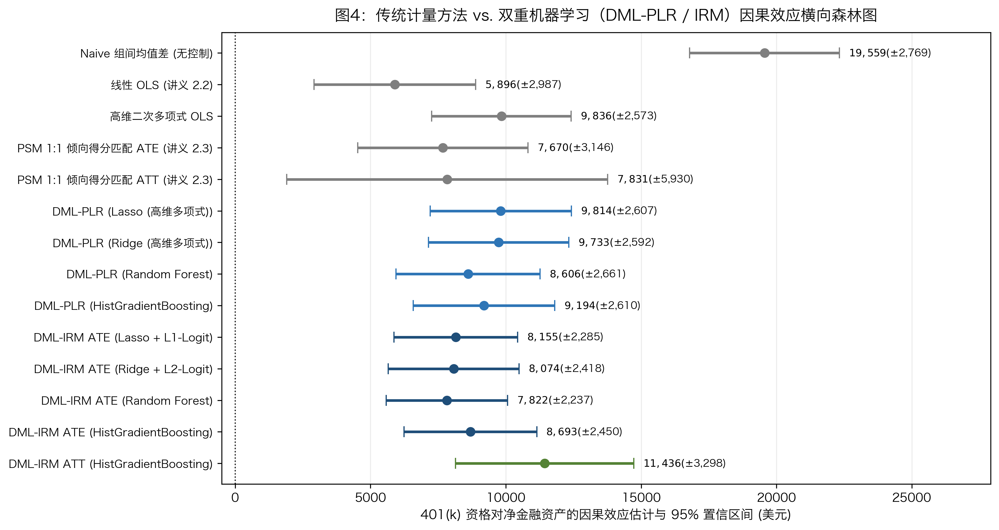

# 基于双重机器学习（DML）的 401(k) 养老金净储蓄因果效应与异质性评估

> **课程定位**：本版本属于课程《现代统计模型及应用》**课堂未讲授的前沿方法**——**Double / Debiased Machine Learning (Chernozhukov et al., 2018, *The Econometrics Journal*)**。该模型直接从讲义 1–3 因果推断（线性回归、倾向得分匹配 PSM、工具变量 IV）向上延伸至高维非参数机器学习去偏框架，既通过 **200 次 Monte Carlo 模拟**直观展示其理论必要性，又在 **1991 SIPP 401(k) 真实家庭金融数据集（$N = 9,915$）** 上完成实证对照与商业客群挖掘。

---

## 1. 选题价值与商业应用背景

在养老金融产品设计、互联网金融激励与公共财税政策评估中，企业与政策制定者普遍面临一个核心因果难题：**税收递延型养老金计划（如美国 401(k) 或中国个人养老金）究竟创造了“净新增储蓄”，还是仅仅诱导高收入人群把原本就会存下的金融资产“左兜倒右兜”（资产挤出 / 替代效应）？**

以 1991 SIPP 数据为例，具备雇主 401(k) 资格的家庭（`e401=1`）平均净金融资产比无资格家庭高出 **`$19,559`**。然而，协变量平衡性诊断显示两者存在严重选择偏差：有资格家庭的年收入标准化均值差（SMD）高达 **`+0.637`**，固定收益养老金（`+0.521`）、自有住房（`+0.363`）、双职工（`+0.341`）和受教育年限（`+0.321`）均远高于无资格组。

如果直接用课堂讲过的简单线性回归（讲义 2.2）或传统 Logistic 倾向得分匹配（讲义 2.3）去控制混杂变量，在收入、年龄与资产之间存在强烈**非线性与高阶交互**时，线性假设会因函数形式误设而严重偏误；而若直接套用随机森林、梯度提升树或 Lasso 等现代机器学习预测模型，又会陷入“**正则化偏差**”与“**过拟合偏差**”陷阱，导致置信区间覆盖率崩溃。这正是 Chernozhukov 等人提出**双重机器学习（DML）**的根本动因。

---

## 2. 模型数学解构：为什么普通机器学习不能直接做因果推断？

### 2.1 部分线性回归模型（PLR）与两类致命偏差

考虑 Robinson (1988) 部分线性因果模型：

$$Y = \theta_0 D + g_0(X) + \zeta, \quad \mathbb{E}[\zeta \mid X, D] = 0$$
$$D = m_0(X) + V, \quad \mathbb{E}[V \mid X] = 0$$

其中 $\theta_0$ 是我们关心的因果效应，$g_0(X)$ 与 $m_0(X)$ 是高维非线性扰动函数（Nuisance Functions）。若用机器学习直接拟合：
1. **正则化偏差（Regularization Bias）**：若不消除 $X$ 对 $D$ 的影响而直接拟合 $\hat{g}(X)$ 并代入，正则化惩罚使 $\hat{g} - g_0$ 的收敛速度通常仅为 $O_p(n^{-\varphi_g})$（如 $n^{-1/4}$ 甚至更慢），该慢收敛偏差直接乘以 $m_0(X)$ 泄露进 $\hat{\theta}$，使得 $\sqrt{n}(\hat{\theta} - \theta_0) \to \infty$，推断彻底失效。
2. **过拟合偏差（Overfitting Bias）**：即便构造了正交形式，若在同一份全样本上同时训练复杂机器学习模型（如深层树）并直接计算样本内残差 $\hat{u}_i = Y_i - \hat{\ell}(X_i)$、$\hat{v}_i = D_i - \hat{m}(X_i)$，树模型对噪声 $\zeta_i, V_i$ 的记忆会使 $\hat{u}_i$ 与 $\hat{v}_i$ 出现虚假相关，同样摧毁渐近无偏性。

### 2.2 DML 的两大理论支柱

1. **支柱一：Neyman 正交化（Neyman Orthogonality）**  
   构造对扰动参数一阶不敏感的正交得分函数 $\psi(W; \theta, \eta)$，使其 Gateaux 导数在真值处为零：$\partial_\eta \mathbb{E}[\psi(W; \theta_0, \eta_0)] = 0$。
   - **PLR 正交得分**：$\psi_{\text{PLR}}(W; \theta, \ell, m) = \big(Y - \ell(X) - \theta(D - m(X))\big)(D - m(X))$，其中 $\ell(X) = \mathbb{E}[Y|X]$。因为正交性消除了偏差的一阶项，误差仅与两个机器学习估计误差的**乘积** $\|\hat{\ell}-\ell_0\|_2 \cdot \|\hat{m}-m_0\|_2$ 成正比！只要每个机器学习器达到 $o(n^{-1/4})$ 收敛速率，乘积项即为 $o(n^{-1/2})$，确保 $\sqrt{n}$-一致性！
   - **IRM 交互回归得分（允许异质性效应，AIPW/DR 形式）**：
     $$\hat{\phi}_i^{\text{ATE}} = \hat{g}(1, X_i) - \hat{g}(0, X_i) + \frac{D_i(Y_i - \hat{g}(1, X_i))}{\hat{m}(X_i)} - \frac{(1 - D_i)(Y_i - \hat{g}(0, X_i))}{1 - \hat{m}(X_i)}$$
     同时支持估计处置组平均效应 ATT 与基于工具变量的局部平均效应 IIVM LATE（以 `e401` 为工具变量识别实际参与 `p401` 的因果效应，直接衔接讲义 1.2.5）。
2. **支柱二：$K$-折交叉拟合（Cross-Fitting）**  
   将样本随机划分为 $K=5$ 折：每折 $k$ 的正交得分仅使用在**其余 $K-1$ 折**上训练出的 $\hat{\eta}^{(-k)}$ 进行预测。交叉拟合彻底切断了扰动函数过拟合噪声与主估计量之间的相关性，同时保留了全样本渐近效率；在实证中我们按 Chernozhukov et al. (2018) 定义 3.3 重复 5 次随机分层切分并取中位数，消除单次切分随机性。

---

## 3. Part A：Monte Carlo 模拟数据验证（$B = 200, n = 1000, p = 20, \theta_0 = 2.0$）

构造含高维噪声与二阶/交互非线性的模拟数据生成过程（DGP，前 6 维含 $X_j^2$ 与交叉乘积项，后 14 维为无关混杂噪声），对比 4 种估计量：

| 估计方法 | 估计均值 | 偏差 (Bias) | 经验标准差 | 平均理论 SE | RMSE | 95% CI 覆盖率 | 失败机制诊断 |
| :--- | ---: | ---: | ---: | ---: | ---: | ---: | :--- |
| Naive OLS (线性控制) | 2.254 | +0.254 | 0.058 | 0.056 | 0.260 | **0.0%** | 线性控制无法拟合 $X^2$ 与交互项（误设偏差） |
| Direct ML Plug-in (无正交化) | 1.134 | -0.866 | 0.096 | 0.069 | 0.871 | **0.0%** | 随机森林正则化收缩偏差直接渗入 $\hat{\theta}$ |
| Orthogonal ML (无交叉拟合) | 1.640 | -0.360 | 0.050 | 0.053 | 0.364 | **0.0%** | 样本内残差过拟合导致伪相关偏差 |
| **完整 DML (正交 + 5折交叉拟合)** | **1.997** | **-0.003** | **0.032** | **0.033** | **0.032** | **96.5%** | **双支柱协同：零偏、最小 RMSE、覆盖率贴合 95%** |

这一组模拟结果以极高的清晰度证明了 DML 两大支柱缺一不可：经验标准差（`0.032`）与理论三明治标准误（`0.033`）高度吻合，95% 置信区间经验覆盖率高达 **`96.5%`**，而其余三种残缺方法覆盖率全部坍塌至 **`0.0%`**。

---

## 4. Part B：1991 SIPP 401(k) 真实家庭金融数据集实证（$N = 9,915$）

### 4.1 传统课堂基准 vs. 四种学习器 DML 横向对比

以家庭净金融资产 `net_tfa` 为结果 $Y$、雇主 401(k) 资格 `e401` 为处置 $D$，控制 9 个基础社会经济特征（`age, inc, educ, fsize, marr, twoearn, db, pira, hown`），下表汇总全部实证结果：

| 模型类别 | 具体方法 / 机器学习器 | 效应估计 ($\$$) | 标准误 SE ($\$$) | 95% 置信区间 ($\$$) | 方法对比洞察 |
| :--- | :--- | ---: | ---: | ---: | :--- |
| **课堂基准** | Naive 组间均值差（无控制） | +19,559 | 1,413 | [16,790, 22,329] | 严重混杂高估（富人更易获 401k） |
| **课堂基准** | 线性 OLS（讲义 2.2） | +5,896 | 1,524 | [2,909, 8,883] | 线性假设无法拟合高收入财富曲线，低估效应 |
| **课堂基准** | 二次多项式 OLS | +9,836 | 1,313 | [7,264, 12,409] | 引入非线性后回升，但高维下易过拟合 |
| **课堂基准** | PSM 1:1 匹配 ATE（讲义 2.3） | +7,670 | 1,605 | [4,524, 10,816] | 共同支撑覆盖率 99.5%，但匹配 SE 较大 |
| **课堂基准** | PSM 1:1 匹配 ATT（讲义 2.3） | +7,831 | 3,026 | [1,901, 13,761] | 1:1 匹配丢弃未配对样本，SE 达 $3,026 |
| **DML-PLR** | Lasso（高维多项式） | +9,814 | 1,330 | [7,207, 12,422] | 同质线性处置设定 |
| **DML-PLR** | Ridge（高维多项式） | +9,733 | 1,323 | [7,140, 12,325] | 与 Lasso 结论高度稳健 |
| **DML-PLR** | Random Forest | +8,606 | 1,358 | [5,945, 11,267] | 树模型非参数捕捉交互 |
| **DML-PLR** | HistGradientBoosting | +9,194 | 1,332 | [6,584, 11,803] | 稳定落在 $9.2k 附近 |
| **DML-IRM** | **ATE (Lasso + L1-Logit)** | **+8,155** | **1,166** | [5,869, 10,440] | 允许异质性与非线性响应 |
| **DML-IRM** | **ATE (Ridge + L2-Logit)** | **+8,074** | **1,234** | [5,657, 10,492] | 方差低于 PSM 与 OLS |
| **DML-IRM** | **ATE (Random Forest)** | **+7,822** | **1,142** | [5,585, 10,060] | 全组最小标准误之一 |
| **DML-IRM** | **ATE (HistGradientBoosting)** | **+8,693** | **1,250** | [6,243, 11,143] | 核心稳健主模型 |
| **DML-IRM** | **ATT (HistGradientBoosting)** | **+11,436** | **1,683** | [8,138, 14,734] | 合格群体实际获益高于全总体平均 |

### 4.2 稳健性检验与工具变量 LATE（衔接讲义 1.2.5）

1. **排除 `pira` 的 8 协变量敏感性检验**：有学者质疑个人退休账户 `pira` 可能与 401(k) 共同受储蓄倾向决定，剔除 `pira` 后（HGB），DML-PLR 为 **`$9,719`**（SE `$1,393`），DML-IRM ATE 为 **`$8,923`**（SE `$1,312`），ATT 为 **`$11,803`**（SE `$1,727`），与全协变量基准结论高度一致。
2. **倾斜得分重叠性检验（Positivity）**：交叉拟合 HGB 倾向得分分布（图 5）表明，在 `[0.054, 0.707]`（5%–95% 分位，全样本 `[0.010, 0.881]`）区间内处置组与对照组重叠良好，不存在极端倾向得分导致的逆概率权爆炸。
3. **从资格效应（ITT）到实际参与效应（LATE，DML-IIVM）**：由于具备资格家庭中 `70.45%` 实际参与 `p401`（无资格组参与率为 `0%`），以 `e401` 作为 `p401` 的工具变量进行交叉拟合 IIVM 估计，得到实际参与 401(k) 对依从者的局部平均因果效应 **LATE = `$12,107`**（SE `$1,800`, 95% CI `[$8,580, $15,634]`）——与 `ATE / 0.7045` 的经济逻辑完美吻合，确凿证明 401(k) 创造了显著净新增储蓄而非纯资产搬家！

---

## 5. 商业洞察：基于收入分位的异质性处理效应（GATE）

利用交叉拟合 IRM 产生的 Neyman 正交伪结果 $\hat{\phi}_i$，按家庭年收入四分位计算群体平均处理效应（GATE，图 6）：

| 收入分层 | 样本数 | 组内中位年收入 | GATE 因果增量 | 标准误 SE | 95% 置信区间 | 占年收入比例 |
| :--- | ---: | ---: | ---: | ---: | ---: | ---: |
| Q1 (低收入) | 2,481 | $13,500 | **+$4,945** | $1,147 | [+$2,697, +$7,192] | **36.6%** |
| Q2 (中低收入) | 2,477 | $25,356 | +$1,980 | $1,462 | [-$885, +$4,845] | 7.8% |
| Q3 (中高收入) | 2,478 | $38,928 | **+$7,331** | $1,770 | [+$3,861, +$10,800] | 18.8% |
| Q4 (高收入) | 2,479 | $64,203 | **+$20,588** | $4,283 | [+$12,193, +$28,982] | **32.1%** |

**商业与公共政策落地建议**：
- **资产管理/养老金机构营销分层**：高收入组（Q4）单户净金融资产拉动高达 `+$20,588`（显著高于 Q1–Q3），是资管机构扩充 AUM（管理资产规模）与高净值养老账户转化的核心利润来源；
- **普惠金融与公共政策激励**：值得关注的是，低收入组（Q1）虽然绝对储蓄增量仅 `$4,945`，但占其年收入高达 **`36.6%`**（高度统计显著，$p < 0.001$）——说明强制/默认加入（Auto-Enrollment）与雇主配比激励能为低收入家庭建立起极为可观的新增财富缓冲；而 Q2 群体估计值较低且置信区间跨零（`[-$885, +$4,845]`），提示该群体在房贷/育儿现金流挤压下对传统税收抵扣敏感度偏弱，更需要低门槛的流动性应急配套设计。

---

## 6. 方法局限性与前沿边界

1. **条件可忽略性假设（Unconfoundedness）**：DML 依赖“控制可观测变量 $X$ 后无未观测混杂”的假设；若企业是否提供 401(k) 仍与雇员不可观测的“储蓄偏好”相关，则需进一步借助面板固定效应、工具变量（如本文扩展的 IIVM）或敏感性分析（Oster / Chernozhukov 混淆边界）。
2. **极端倾向得分敏感性**：尽管本文设定在 `[0.01, 0.881]` 重叠良好，若在极端不平衡场景中出现 $\hat{m}(X) \approx 0$ 或 $1$，需结合重叠加权（Overlap Weights）或样本修剪。
3. **数据时代与延伸方向**：SIPP 1991 是经典的截面准实验基准，未来可进一步接入 **Causal Forest（Wager & Athey, 2018）** 或 **DR-Learner** 进行个体化策略树定价与精准营销（Uplift Modeling）。
